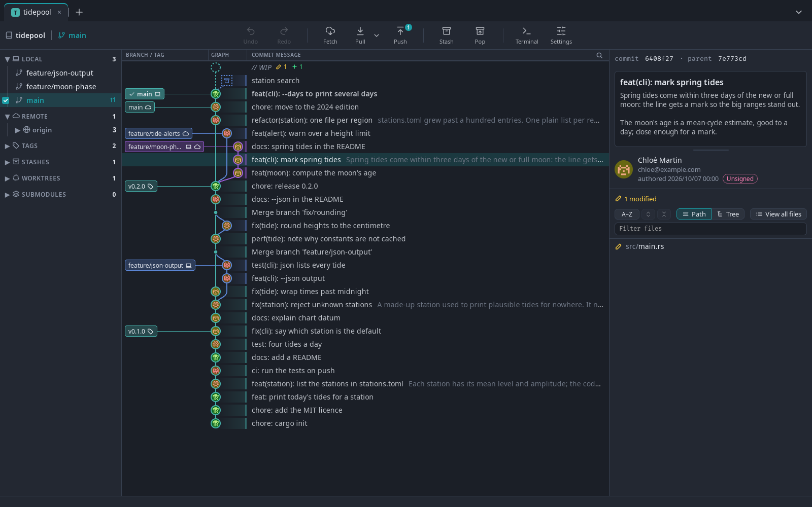
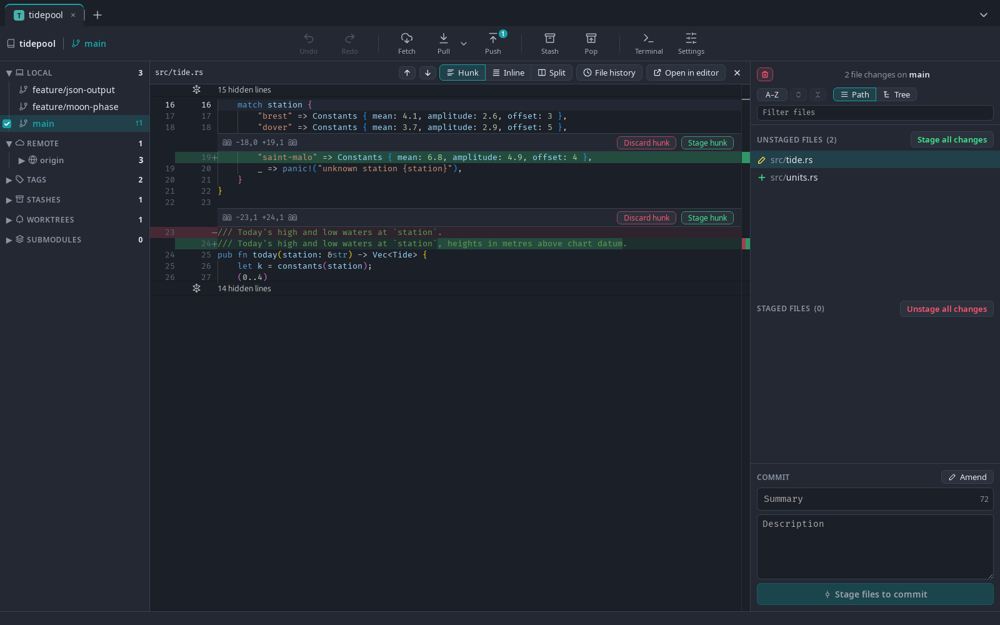
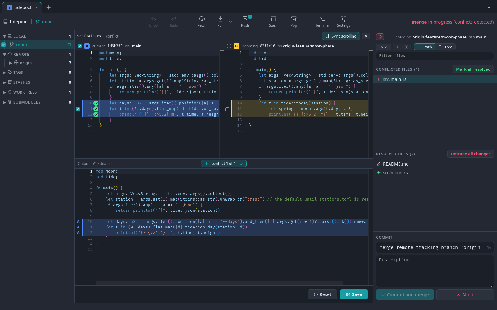
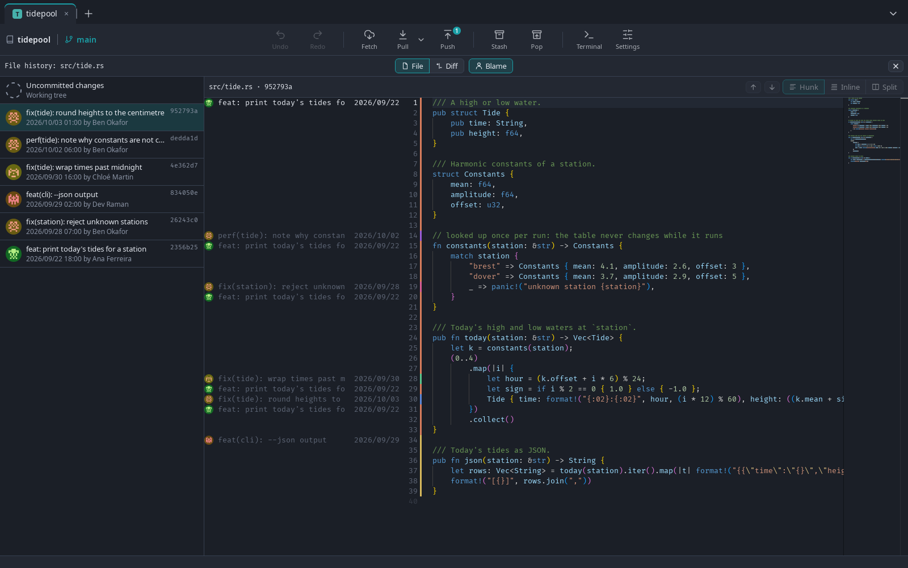

<h1 align="center"> Git Krill</h1>

A lean desktop git client for Linux, Windows and macOS: a commit graph, diffs you can stage from, a merge tool, and little else. It runs the `git` you already have, so your config, hooks, keys and credentials apply as usual.



## Features

- **Graph**: every branch in lanes, with search; checkout, merge, rebase and reset from the menus.
- **Staging**: whole files, hunks or single lines; commit, amend, discard with undo.
- **Diffs**: hunk, inline or side by side, editable in place; images side by side.
- **Merge tool**: three panes, picks per hunk or per line.
- **Interactive rebase**: reorder, reword, squash, drop.
- **File history** with blame.
- **Sidebar**: branches, remotes, tags, stashes, worktrees and submodules.
- **Git LFS**: diffs by content, track and untrack from the menus.
- **Tabs**, one repository each, with a terminal.

## Screenshots

### Diff and staging



### Merge tool



### File history and blame



## Install

From the [releases](https://github.com/jean-roland/git-krill/releases):

- **Linux** (Debian, Ubuntu): `sudo apt install ./git-krill_0.2.0_amd64.deb`, then run `git-krill`, or `git-krill path/to/repo`.
- **Windows**: run `git-krill_0.2.0_x64-setup.exe`. It is not signed: SmartScreen asks first, "More info" then "Run anyway". Needs [Git for Windows](https://git-scm.com/download/win).
- **macOS**: open `git-krill_0.2.0_universal.dmg` and drag Git Krill to Applications. It is not notarized: the first launch is refused, then System Settings > Privacy & Security > "Open Anyway". Needs git: `xcode-select --install`, or Homebrew's.

Needs `git` (tested with 2.43; before 2.40 a commit's files lack their LFS chip). "Open in editor" runs the command set in Settings, VS Code's `code` by default.

## Build

Needs Rust 1.88 or newer, Node.js 18 or newer, and Tauri's system libraries (on Windows and macOS, see Tauri's [prerequisites](https://v2.tauri.app/start/prerequisites/)):

```sh
sudo apt install libwebkit2gtk-4.1-dev build-essential curl wget file libxdo-dev libssl-dev libayatana-appindicator3-dev librsvg2-dev
npm install
npx tauri build              # the .deb lands in src-tauri/target/release/bundle/deb/
npx tauri build --no-bundle  # the bare binary only: src-tauri/target/release/git-krill
npm test
```

## Keys

| Key | Action |
| --- | --- |
| Ctrl+T, Ctrl+W, Ctrl+Shift+T | New tab, close it, reopen the last closed |
| Ctrl+Tab, Ctrl+Shift+Tab | Next, previous tab |
| Ctrl+O | Open a repository |
| Alt+← | Back from a worktree or a submodule to its repository |
| Ctrl+F | Search the graph |
| Ctrl+Z, Ctrl+Y | Undo, redo |
| Ctrl+` | Terminal |
| F5 | Refresh |
| Arrows | Move through commits and files, open and close diffs |
| Escape | Close the open view or dialog |

On macOS, Cmd in place of Ctrl, but for Ctrl+Tab and Ctrl+`.

## Licence

[MIT](LICENSE)
