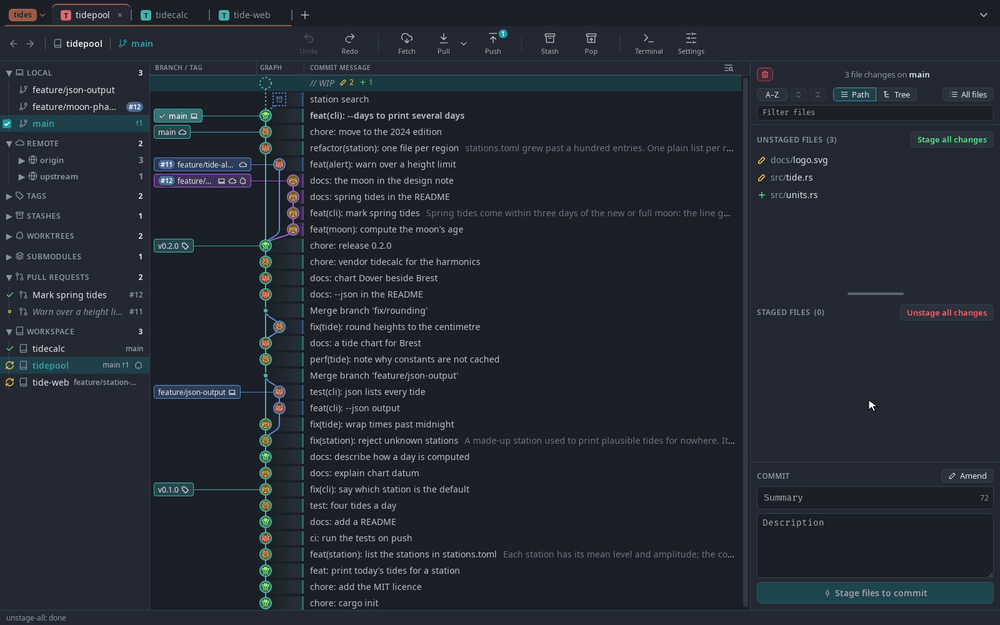
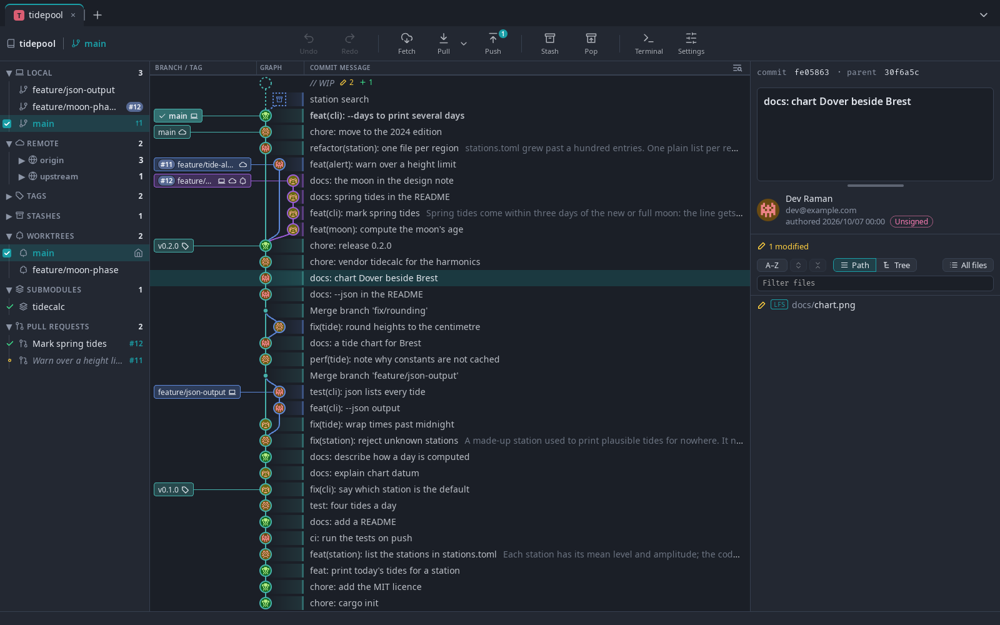
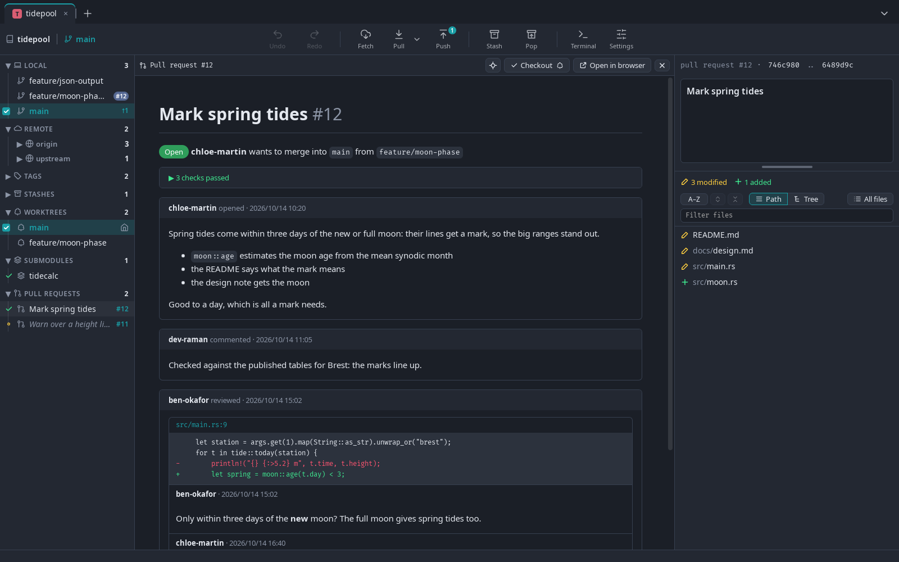
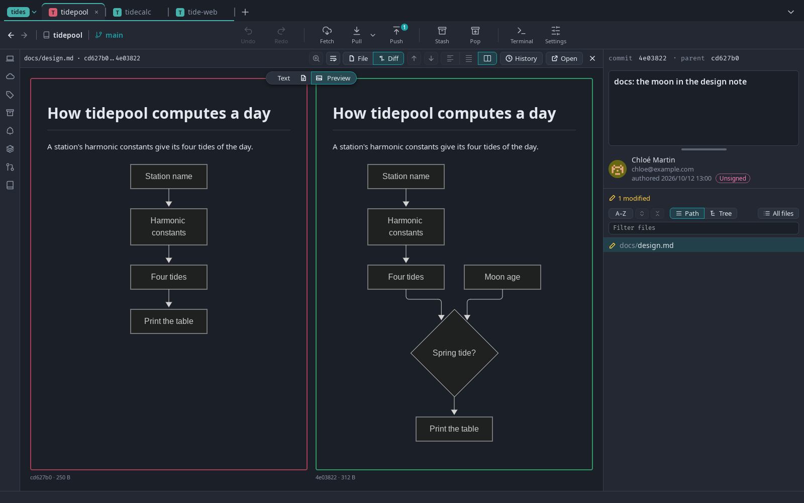
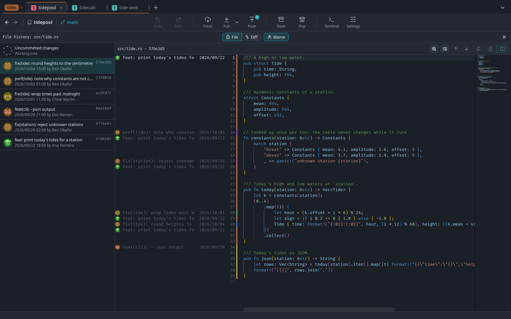

<h1 align="center"> Git Krill</h1>

A lean desktop git client for Linux, Windows and macOS: a clean interface, power features included, from interactive rebase to pull requests. It runs the `git` you already have, so your config, hooks, keys and credentials apply as usual.



## Features

- **Git Workflow**: explore the commit graph, manage branches, stashes and rebases in a click. Stage down to a single line.
- **Diffs**: inspect changes by hunk, inline or side by side, or the whole file alone, and edit uncommitted ones in place.
- **Tabs**: work across multiple repositories in dedicated tabs, each paired with a built-in terminal, and gather them in named groups that fold away.
- **Conflicts**: resolve tricky merges in a three-pane editor, picking changes by the hunk or down to the individual line.
- **History**: step through past revisions of a file with inline blame so you know who changed what and why.
- **Rebase**: clean up commit history visually by reordering, rewording, squashing or dropping commits, individually or in bulk.
- **Pull requests**, powered by the GitHub CLI: check CI statuses, read review threads or open new PRs without leaving the app.
- **Previews**: render Markdown, HTML and SVG. View PDFs, inspect images and binaries or open any file in its default app.
- **Advanced Git**: manage worktrees, submodules, LFS files and repo tool checkouts right from the interface.

## Screenshots

### Commit graph



### Pull requests



### Markdown preview



### Merge tool


### File history and blame



## Install

From the [releases](https://github.com/jean-roland/git-krill/releases):

- **Linux** (Debian, Ubuntu): `sudo apt install ./git-krill_0.5.2_linux.deb`, then run `git-krill`, or `git-krill path/to/repo`.
- **Windows**: run `git-krill_0.5.2_windows.exe`. It is not signed: SmartScreen asks first, "More info" then "Run anyway". Needs [Git for Windows](https://git-scm.com/download/win).
- **macOS**: open `git-krill_0.5.2_macOS.dmg` and drag Git Krill to Applications. It is not notarized: the first launch is refused, then System Settings > Privacy & Security > "Open Anyway". Needs git: `xcode-select --install`, or Homebrew's.

Needs `git` (tested with 2.43; before 2.40 a commit's files lack their LFS chip). A diff's Open button runs the editor command set in Settings, VS Code's `code` by default.

## Keys

| Key | Action |
| --- | --- |
| Ctrl+T, Ctrl+W, Ctrl+Shift+T | New tab, close it, reopen the last closed |
| Ctrl+Tab, Ctrl+Shift+Tab | Next, previous tab |
| Ctrl+O | Open repositories, several at once with Ctrl or Shift+click in the picker |
| Ctrl+N, Ctrl+I | Clone a repository, start one in a folder |
| Alt+← | Back from a worktree or a submodule to its repository |
| Ctrl+F | Search the graph |
| Ctrl+Z, Ctrl+Y | Undo, redo |
| Ctrl+` | Terminal |
| F5 | Refresh |
| Arrows | Move through commits and files, open and close diffs |
| Escape | Close the open view or dialog; on the graph, back from a worktree or a submodule |
| P, N | Previous, next change in a diff |
| Ctrl+=, Ctrl+-, Ctrl+0, Ctrl+wheel | Text zoom in a diff or a file's history: in, out, back to 100% |
| Alt+Z | Word wrap in a diff or a file's history |
| Space | Fit a zoomed image back (the mouse wheel zooms, a drag pans) |
| Ctrl+click, Shift+click | Pick several files of a WIP list, to stage, discard, stash or ignore them together, or several rows of an interactive rebase |

On macOS, Cmd in place of Ctrl, but for Ctrl+Tab and Ctrl+`.

## Build

Needs Rust 1.88 or newer, Node.js 18 or newer, and Tauri's system libraries (on Windows and macOS, see Tauri's [prerequisites](https://v2.tauri.app/start/prerequisites/)):

```sh
sudo apt install libwebkit2gtk-4.1-dev build-essential curl wget file libxdo-dev libssl-dev libayatana-appindicator3-dev librsvg2-dev
npm install
npx tauri build              # the .deb lands in src-tauri/target/release/bundle/deb/
npx tauri build --no-bundle  # the bare binary only: src-tauri/target/release/git-krill
npm test
```

End-to-end tests drive the debug build through WebDriver on Linux, each in a fresh profile on throwaway repositories. They need a display (`xvfb-run` without one), `WebKitWebDriver` and `tauri-driver`:

```sh
sudo apt install webkit2gtk-driver
cargo install tauri-driver --locked
npx tauri build --debug --no-bundle
npm run e2e                  # screenshots in e2e/out; CI also compares them with e2e/golden
```

## Trace mode

When an action is slow or never ends, a trace shows where the time goes. Start Git Krill with `KRILL_TRACE` set to a file, repeat the action, then quit:

```sh
# Linux
KRILL_TRACE=~/krill-trace.txt git-krill
# macOS
KRILL_TRACE=~/krill-trace.txt "/Applications/Git Krill.app/Contents/MacOS/git-krill"
```

On Windows, in PowerShell:

```powershell
$env:KRILL_TRACE = "$HOME\krill-trace.txt"; & "$env:LOCALAPPDATA\Git Krill\git-krill.exe"
```

Each line is the time since start, how long the step took, then the step:

```
     501     15ms git rev-parse --show-toplevel
     885     40ms call status
     935     94ms refresh tidepool: 47ms for status, log and refs, 47ms for the rest
    2410    312ms op checkout, its refresh included
```

- `git`: one git command, as Git Krill ran it.
- `call`: one request from the window to the backend; its git commands come just before it.
- `refresh`: reloading a repository after a change.
- `op`: a whole action, from the click to its refresh.

Look for the long durations. A slow `git` line is git itself: run the same command in a terminal, in that repository, to confirm (a network drive, an antivirus scanning `.git` and very big repositories are the usual causes). A slow `call`, `refresh` or `op` whose git lines are quick is Git Krill's own: open an issue and attach the trace.

The trace holds each git command with its arguments, so file paths, branch names and commit messages: read it before you share it. Passwords in remote URLs are left out.

## Licence

[MIT](LICENSE)
